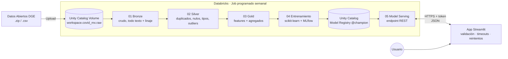
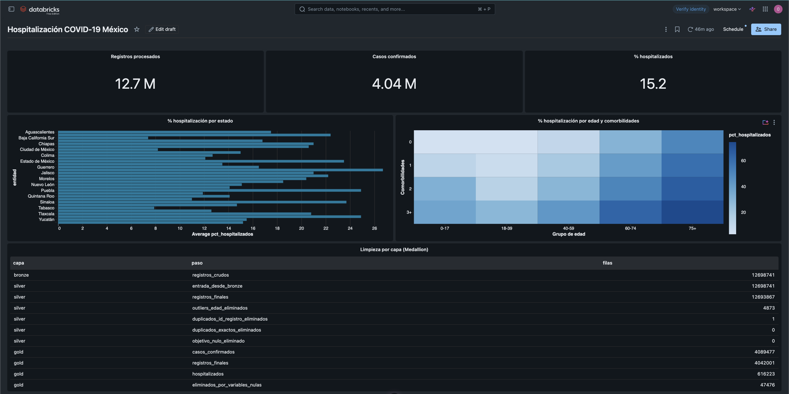

# 🏥 Riesgo de hospitalización por COVID-19 en México

> Pipeline de Big Data con **arquitectura Medallion en Databricks (PySpark)**, modelo de **Machine Learning** registrado con **MLflow**, publicado como **endpoint REST** y consumido por una **aplicación web**.

Proyecto final de **Aprendizaje Automático para Grandes Volúmenes de Datos**, Universidad Panamericana.
Autor: **Rodrigo Ramírez** (proyecto individual).

---

## Tabla de contenido

- [El problema](#-el-problema)
- [Arquitectura](#-arquitectura)
- [Datos](#-datos)
- [Limpieza y transformación (Medallion)](#-limpieza-y-transformación-medallion)
- [Definición del problema y métricas](#-definición-del-problema-y-métricas)
- [Resultados](#-resultados)
- [Publicación del modelo (API)](#-publicación-del-modelo-api)
- [Aplicación de consulta](#-aplicación-de-consulta)
- [Dashboard](#-dashboard)
- [Cómo ejecutarlo](#-cómo-ejecutarlo)
- [Estructura del repositorio](#-estructura-del-repositorio)
- [Limitaciones y trabajo futuro](#-limitaciones-y-trabajo-futuro)

---

## 🎯 El problema

Durante la pandemia, la saturación hospitalaria fue uno de los mayores problemas en México. Con la información que un paciente puede dar **al llegar a consulta** (sexo, edad, embarazo, comorbilidades y estado donde vive), ¿qué tan probable es que su caso termine en **hospitalización**?

Un modelo así sirve para **priorizar seguimiento** de pacientes de alto riesgo y para **anticipar la demanda de camas**. El sistema completo:

1. Ingiere **millones de registros** de la Dirección General de Epidemiología (DGE).
2. Los depura por capas **Bronze → Silver → Gold** con PySpark.
3. Entrena y registra un clasificador con MLflow.
4. Lo publica como **API REST**.
5. Una **página web** consulta la API y muestra la probabilidad de hospitalización.

> ⚠️ Proyecto académico. No es una herramienta de diagnóstico médico.

## 🏗 Arquitectura



| Componente | Tecnología |
|---|---|
| Almacenamiento | Delta Lake sobre Unity Catalog (`workspace.covid_mx`) |
| Procesamiento | PySpark (serverless) |
| Orquestación | Databricks Jobs: 5 tareas encadenadas, programadas cada lunes 06:00 |
| Modelo | scikit-learn (`HistGradientBoostingClassifier` vs. `LogisticRegression`) |
| Registro / versionado | MLflow + Unity Catalog Model Registry (alias `champion`) |
| Publicación | Databricks Model Serving (CPU, scale-to-zero) + especificación OpenAPI |
| Aplicación | Streamlit + `requests` + Pydantic |

## 📊 Datos

- **Fuente:** [Datos Abiertos COVID-19, Secretaría de Salud / DGE](https://www.gob.mx/salud/documentos/datos-abiertos-bases-historicas-direccion-general-de-epidemiologia) (bases históricas).
- **Volumen:** **12,698,741 registros** en Bronze (cierres 2020: 3,868,396 y 2021: 8,830,345), más del triple de los 4 millones que pide el proyecto. El notebook 01 lo verifica y falla si hay menos.
- **Granularidad:** un registro por persona estudiada (sospechosa de COVID-19), con más de 40 columnas: demografía, comorbilidades, fechas, tipo de paciente, resultado de laboratorio y clasificación final.
- **Codificación original:** `1 = SÍ`, `2 = NO`, `97 = NO APLICA`, `98 = SE IGNORA`, `99 = NO ESPECIFICADO`. Fecha de defunción `9999-99-99` = no falleció.

## 🧹 Limpieza y transformación (Medallion)

Los archivos originales **nunca se modifican**. Cada capa lee la anterior y escribe una tabla Delta nueva.

### 🥉 Bronze: `bronze_covid` ([01_bronze](notebooks/01_bronze.py))
- Descomprime los `.zip` del Volume y lee cada CSV **como texto** (sin inferir esquema) para no perder ni alterar nada.
- Une archivos de distintos cortes con `unionByName(allowMissingColumns=True)`.
- Agrega linaje: `_archivo_origen`, `_fecha_ingesta`.

### 🥈 Silver: `silver_covid` ([02_silver](notebooks/02_silver.py))

| Problema | Tratamiento | Justificación |
|---|---|---|
| Duplicados exactos | `dropDuplicates` | Varios cortes pueden traer la misma fila. |
| Mismo paciente en varios cortes (`ID_REGISTRO`) | Se conserva la `FECHA_ACTUALIZACION` más reciente (`row_number` sobre una ventana) | Un caso se actualiza con el tiempo; la versión más nueva es la correcta. |
| Códigos 97/98/99 | → `NULL` | Son "sin dato" según el diccionario; dejarlos como número sesgaría al modelo. |
| SÍ/NO = 1/2 | → 1/0 | Convención binaria. |
| Embarazo en hombres (97) | → 0 | No es un faltante, es lógicamente "no". |
| Tipos de dato | Texto → `INT`/`DATE` con `try_cast` | Una fila mal capturada no tumba el pipeline; queda NULL y se reporta. |
| `FECHA_DEF = 9999-99-99` | → `NULL` + bandera `fallecio` | Valor centinela. |
| **Outliers** de edad | Se eliminan `< 0` o `> 110` | Regla de dominio (error de captura). **No se usa IQR**: recortaría adultos mayores reales, justo el grupo de mayor riesgo. |
| Objetivo nulo | Se elimina la fila | Sin etiqueta no se puede entrenar ni evaluar. |

Cada paso registra cuántas filas afectó en la tabla **`calidad_datos`**:

| Paso | Filas |
|---|---|
| registros_crudos (Bronze) | 12,698,741 |
| duplicados_exactos_eliminados | 0 |
| duplicados_id_registro_eliminados | 1 |
| nulos por comorbilidad ("se ignora", 98) | ~68,000–71,000 cada una (otra_comorbilidad: 206,895) |
| nulos en embarazo (mujeres sin dato) | 42,766 |
| outliers_edad_eliminados | 4,873 |
| registros_finales (Silver) | 12,693,867 |
| casos_confirmados (Gold) | 4,089,477 |
| eliminados_por_variables_nulas (Gold) | 47,476 (1.2 %) |
| registros_finales (Gold) | 4,042,001 |
| hospitalizados | 616,223 (15.2 %) |

> Cifras de la **validación local** ([`scripts/validacion_local.py`](scripts/validacion_local.py)), que replica en pandas las mismas reglas del pipeline de PySpark sobre los mismos archivos. La ejecución en Databricks las registra en la tabla `calidad_datos`.

### 🥇 Gold ([03_gold](notebooks/03_gold.py))
- **`gold_features_hospitalizacion`:** solo casos **confirmados** (`CLASIFICACION_FINAL` 1–3), con 14 variables conocidas *al llegar a consulta* + objetivo `hospitalizado`.
- **Se excluyen** `neumonia`, `intubado`, `uci` y `fecha_def` como predictores porque ocurren durante o después de la hospitalización (**fuga de información**).
- Filas con alguna comorbilidad "se ignora" se eliminan en lugar de imputar "NO" (imputar sesgaría hacia pacientes sanos; con millones de filas, el impacto es mínimo y queda documentado).
- **`gold_resumen_entidad`** y **`gold_resumen_perfil`:** tasas de hospitalización por estado y por perfil (edad × número de comorbilidades) para el análisis.

**Normalización y codificación** (dentro del `Pipeline` de scikit-learn, para que el endpoint aplique exactamente la misma transformación):
- `StandardScaler` → `edad`, `n_comorbilidades`
- `OneHotEncoder` → `entidad_res` (categórica nominal, no ordinal), `grupo_edad`
- Binarias 0/1 → passthrough

## 📐 Definición del problema y métricas

- **Tarea:** clasificación binaria supervisada: `hospitalizado = 1` vs. ambulatorio `= 0`.
- **Clases desbalanceadas:** solo el **15.2 %** de los confirmados se hospitaliza.
- **Métrica principal: F1 de la clase positiva.** El *accuracy* engaña (decir siempre "ambulatorio" daría un accuracy alto y no detectaría a nadie). F1 balancea:
  - **Recall**: no dejar pasar pacientes que sí se hospitalizarán (el error más costoso en salud).
  - **Precision**: no saturar con falsas alarmas.
- **Métricas de apoyo:** ROC-AUC y PR-AUC (independientes del umbral).
- **Protocolo:** muestra estratificada de Gold → partición 70/15/15 estratificada → `class_weight="balanced"` → umbral óptimo de F1 elegido en **validación** → métricas finales en **prueba**.

> ¿Por qué entrenar con una muestra? Spark hace el trabajo pesado sobre todas las filas; para un modelo tabular de 14 variables, una muestra estratificada de ~1.5 M filas ya representa perfectamente la distribución y cabe en memoria del cómputo serverless.

## 📈 Resultados

Muestra estratificada de 1.5 M de los 4.04 M registros de Gold (70/15/15). Valores de la validación local; en Databricks quedan en MLflow (Experiments → `covid_hospitalizacion_mx`).

| Modelo | F1 (val) | Recall (val) | Precision (val) | ROC-AUC (val) | PR-AUC (val) |
|---|---|---|---|---|---|
| Regresión logística | 0.539 | 0.616 | 0.479 | 0.843 | 0.530 |
| **Gradient Boosting** ✅ | **0.545** | 0.613 | 0.491 | **0.851** | **0.546** |

**Modelo final (Gradient Boosting) en PRUEBA:** F1 = **0.550** · Recall = 0.618 · Precision = 0.496 · ROC-AUC = 0.854 · PR-AUC = 0.555 · umbral = 0.276 (en escala de probabilidad real)

**Probabilidades calibradas.** Entrenar con `class_weight="balanced"` equivale a fingir que la mitad de los pacientes se hospitaliza: ayuda a detectar la clase minoritaria, pero infla las probabilidades. Antes de responder, el modelo aplica una **corrección de prior** (momios × π/(1−π), con π = 15.2 %) que regresa cada puntaje a la escala real sin cambiar el orden ni las decisiones. En prueba, la probabilidad promedio es 15.2 % contra una tasa real de 15.2 %, y por deciles coincide (el decil más alto predice 61.4 % y en realidad se hospitalizó el 62.4 %).

**Línea base:** un modelo trivial que marca a *todos* como hospitalizados obtiene F1 = **0.265**. El modelo la supera **2.1 veces** (0.550).

Cómo leerlo: de cada 100 pacientes que sí terminaron hospitalizados, el modelo detecta a ~62; y de cada 2 alertas, ~1 es correcta. Con una base de 15 % de positivos, un PR-AUC de 0.555 es 3.6 veces mejor que adivinar.

**¿Qué variables pesan más?** Importancia por permutación (cuánto cae el PR-AUC si se revuelve cada variable), sobre 200 mil registros de prueba:

| Variable | Caída del PR-AUC |
|---|---|
| Edad | 0.271 |
| Entidad de residencia | 0.073 |
| Diabetes | 0.025 |
| Enfermedad renal crónica | 0.019 |
| Sexo | 0.016 |
| Obesidad | 0.008 |
| Otra comorbilidad | 0.007 |
| Hipertensión | 0.006 |
| Resto (inmunosupresión, EPOC, embarazo, tabaquismo, cardiovascular, asma) | < 0.003 cada una |

La edad domina por mucho. La entidad importa porque cada estado tuvo criterios y capacidad hospitalaria distintos, y entre las comorbilidades destacan diabetes y enfermedad renal crónica.

**Hallazgos de Gold** (`gold_resumen_perfil`), tasa de hospitalización por perfil:

| Edad | 0 comorbilidades | 1 | 2 | 3+ |
|---|---|---|---|---|
| 18–39 | 3.4 % | 7.4 % | 14.3 % | 29.3 % |
| 40–59 | 10.9 % | 19.7 % | 29.5 % | 43.4 % |
| 60–74 | 31.0 % | 41.1 % | 51.4 % | 64.2 % |
| 75+ | 50.7 % | 60.1 % | 66.9 % | 74.8 % |

Una persona de 60–74 años con 3 o más comorbilidades se hospitalizó **19 veces más** que una de 18–39 sin comorbilidades (64.2 % vs. 3.4 %).

## 🚀 Publicación del modelo (API)

- **Endpoint gestionado:** Databricks Model Serving `covid-hospitalizacion` → `POST https://<workspace>/serving-endpoints/covid-hospitalizacion/invocations`
- **Autenticación:** `Authorization: Bearer <token>`
- **Documentación OpenAPI:** [`api/openapi.yaml`](api/openapi.yaml) (ábrela en [Swagger Editor](https://editor.swagger.io)). El notebook 05 además descarga la especificación que genera Databricks.
- **Validación de entradas en el servidor:**
  1. La *signature* de MLflow rechaza columnas faltantes, columnas extra y tipos incorrectos.
  2. [`validar_entrada`](src/modelo_covid.py) revisa reglas de negocio: edad 0–110, binarias 0/1, entidad 1–32, embarazo solo si es mujer. → **HTTP 400** con el motivo.

**Ejemplo:**

```bash
curl -X POST "$DATABRICKS_HOST/serving-endpoints/covid-hospitalizacion/invocations" \
  -H "Authorization: Bearer $DATABRICKS_TOKEN" -H "Content-Type: application/json" \
  -d '{"dataframe_records":[{"es_mujer":0,"edad":67,"embarazo":0,"entidad_res":14,
       "diabetes":1,"epoc":0,"asma":0,"inmunosupresion":0,"hipertension":1,
       "cardiovascular":0,"obesidad":1,"renal_cronica":0,"tabaquismo":0,"otra_comorbilidad":0}]}'
```

```json
{"predictions": [{"probabilidad": 0.62, "hospitalizacion_predicha": 1, "nivel_riesgo": "alto"}]}
```

## 🖥 Aplicación de consulta

[`app/app.py`](app/app.py) (Streamlit) consume **el endpoint publicado**; no carga ningún modelo local. El cliente [`app/cliente_modelo.py`](app/cliente_modelo.py) maneja:

| Situación | Manejo |
|---|---|
| Datos capturados inválidos | Validación previa con Pydantic (`strict`, rangos, regla embarazo/sexo); no se llama al API |
| Timeout / sin conexión | Timeout de conexión 5 s y de lectura 60 s; **3 reintentos con espera exponencial** |
| Endpoint "despertando" (scale-to-zero), 429, 5xx | Reintentos; mensaje claro si se agotan |
| 401 / 403 | "Token inválido o sin permisos" (sin reintentar) |
| 404 | "El endpoint no existe" |
| 400 | Muestra el motivo de rechazo del servidor |
| Respuesta inválida (no JSON, sin `predictions`, probabilidad fuera de [0,1], nivel desconocido) | `RespuestaInvalida` validada con Pydantic |

La barra lateral muestra el estado del endpoint (`READY`/`NOT_READY`) y un panel deja ver la solicitud y la respuesta JSON reales. Las pruebas en [`tests/`](tests) cubren estos casos con respuestas simuladas.

## 📊 Dashboard

Dashboard de **Databricks AI/BI** construido directamente sobre las tablas de la capa Gold y el reporte `calidad_datos`. Se actualiza solo cada vez que corre el Job. Muestra el volumen procesado, la tasa de hospitalización por estado y por perfil (edad × comorbilidades), y la trazabilidad de la limpieza por capa.



## ▶️ Cómo ejecutarlo

### 1. Databricks (Free Edition)
1. **Workspace → Create → Git folder** → URL de este repositorio.
2. Abre `notebooks/00_config` y córrelo una vez (crea el esquema `covid_mx` y el Volume `raw`).
3. Descarga uno o varios `.zip` de las [bases históricas de la DGE](https://www.gob.mx/salud/documentos/datos-abiertos-bases-historicas-direccion-general-de-epidemiologia) y súbelos en **Catalog → workspace → covid_mx → raw → Upload to this volume**.
4. **Jobs & Pipelines → Create job**: 5 tareas de tipo Notebook encadenadas (`01_bronze → 02_silver → 03_gold → 04_entrenamiento → 05_publicar_endpoint`), cómputo *Serverless*, programación semanal. (Referencia: [`jobs/job_pipeline_covid.json`](jobs/job_pipeline_covid.json)).
5. **Run now.** Al terminar, el endpoint `covid-hospitalizacion` aparece en **Serving**.

### 2. Aplicación (local)
```bash
cd app
python3 -m venv .venv && source .venv/bin/activate
pip install -r requirements.txt
cp .env.example .env      # llenar DATABRICKS_HOST y DATABRICKS_TOKEN
streamlit run app.py
```

### 3. Pruebas
```bash
pip install pandas scikit-learn pydantic requests pytest
python -m pytest -q
```

## 📁 Estructura del repositorio

```
├── notebooks/
│   ├── 00_config.py              # catálogo, esquema, nombres de tablas/modelo/endpoint
│   ├── 01_bronze.py              # ingesta cruda + linaje
│   ├── 02_silver.py              # limpieza justificada + reporte de calidad
│   ├── 03_gold.py                # features del modelo + agregados
│   ├── 04_entrenamiento.py       # entrenamiento, métricas, MLflow, registro UC
│   └── 05_publicar_endpoint.py   # Model Serving + prueba + OpenAPI
├── src/
│   ├── modelo_covid.py           # validación, features, pipeline, métricas (sin Spark)
│   └── pyfunc_wrapper.py         # envoltura MLflow que usa el endpoint
├── app/
│   ├── app.py                    # interfaz Streamlit
│   ├── cliente_modelo.py         # cliente HTTP robusto
│   ├── requirements.txt
│   └── .env.example
├── api/openapi.yaml              # documentación del API
├── jobs/job_pipeline_covid.json  # definición del Job
├── scripts/validacion_local.py   # réplica en pandas para validar reglas y métricas
└── tests/                        # pytest: modelo y cliente
```

## 🚧 Limitaciones y trabajo futuro

- El riesgo cambió a lo largo de la pandemia (variantes, vacunación); el modelo no incluye la fecha. Siguiente paso: agregar la ola epidémica o el estatus de vacunación.
- `TIPO_PACIENTE` refleja la decisión del médico y la disponibilidad de camas, no solo la gravedad.
- Las comorbilidades son autorreportadas.
- Trabajo futuro: reentrenamiento solo cuando cambie la distribución de los datos (*data drift*).

---

<sub>Datos: Secretaría de Salud, Dirección General de Epidemiología, Datos Abiertos (uso libre con atribución).</sub>
